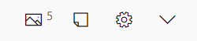
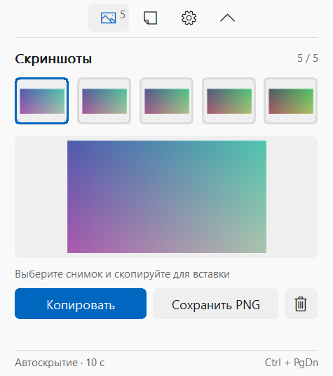
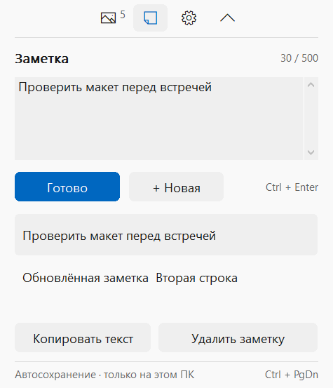
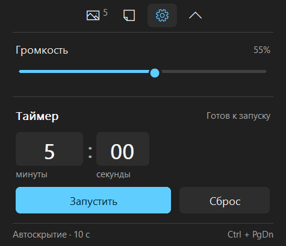

# Island for Windows

A small native Windows capsule for clipboard images, quick notes, volume and a timer. Built with **C++17 and Win32**, without Electron or a bundled browser.

**Island** — компактная панель для Windows 10/11 x64. Вызывается горячей клавишей и появляется на мониторе с курсором мыши.



## Возможности

- **История из пяти изображений:** автоматический подхват из буфера Windows, предпросмотр, копирование и экспорт в PNG. Шестое изображение вытесняет самое старое; дубликаты не добавляются.
- **Короткие заметки:** до 500 символов, автосохранение, редактирование и копирование текста.
- **Громкость:** управление текущим устройством вывода Windows.
- **Таймер:** минуты и секунды, пауза, продолжение, сброс и звуковой сигнал.
- **Несколько мониторов:** выбор по положению курсора при вызове, учёт рабочей области и DPI.
- **Компактность:** капсула 200 × 42 логических пикселя, раскрытые панели шириной 380 пикселей.
- Светлая и тёмная тема Windows, значок в трее, автоскрытие через 10 секунд.

## Запуск

Запустите `Island.exe`. Приложение появится в системном трее; автозапуск не включается. Для обновления завершите старый экземпляр через меню значка → **Выход**, затем запустите новую сборку.

| Действие | Управление |
| --- | --- |
| Показать на экране с курсором | `Ctrl + PgUp` |
| Скрыть | `Ctrl + PgDn` или `Esc` |
| Открыть раздел | Значок изображения, заметки или шестерёнки |
| Свернуть / раскрыть панель | Стрелка справа |
| Сохранить заметку сразу | `Ctrl + Enter` или «Готово» |
| Сделать скриншот средствами Windows | `Win + Shift + S` |

Пока поле заметки имеет фокус, автоскрытие приостановлено. Новые изображения и завершение таймера не открывают панель автоматически.

## Интерфейс

Изображения ниже получены из отрисовки приложения с демонстрационными данными.

| Скриншоты | Заметки |
| --- | --- |
|  |  |



## Данные и ресурсы

Данные остаются на компьютере в `%LOCALAPPDATA%\Island`: PNG в папке `shots`, заметки в `notes.dat`. Они сохраняются между запусками. Приложение не делает сетевых запросов и не отправляет телеметрию.

Подхват изображений работает по уведомлениям Windows, без постоянного опроса буфера. При скрытии панели уменьшенные превью освобождаются. Работающий таймер продолжает отсчёт в фоне; при выходе из приложения он отменяется.

Поддерживаются bitmap/DIB-изображения до 32 миллионов пикселей. Копирование пути, ссылки или файла в Проводнике не считается копированием изображения. Содержимое буфера, существовавшее до запуска Island, автоматически не импортируется.

## Сборка

Требуются Windows x64, PowerShell и MinGW-w64: GCC с поддержкой C++17 и `windres` в `PATH`.

```powershell
.\source\build.ps1
```

Результат — `Island.exe` в корне проекта. Библиотеки GCC связываются статически; динамические зависимости — системные библиотеки Windows. Для запуска не нужны MinGW, .NET или отдельный VC++ Redistributable.

## Проверки

```powershell
.\source\test.ps1
```

Скрипт создаёт отдельную временную папку и не подключает тестовый экземпляр к пользовательскому буферу обмена. Проверяются хранение пяти PNG, дубликаты, заметки, защита повреждённого файла, автоскрытие, таймер и размещение по мониторам. Тесты также сохраняют изображения интерфейса для визуальной проверки.

Проверки версии 2.1 прошли на двух обнаруженных дисплеях. Расчёт геометрии покрывает отрицательные координаты и масштаб 100%, 125%, 150% и 200%. Реальная вставка в сторонние приложения автоматически не проверялась; в изолированном тестовом рабочем столе доступ к позиции курсора может отсутствовать.

## Структура

```text
source/main.cpp             окно, элементы управления, буфер, монитор и системные API
source/storage.h            PNG-история и атомарное сохранение заметок
source/timer.h              логика таймера
source/integration_test.h   интеграционные проверки и отрисовка
source/timer_test.cpp       проверки таймера
source/build.ps1            сборка приложения
source/test.ps1             сборка и запуск проверок
docs/USAGE.ru.md            подробная инструкция
```

История изменений: [CHANGELOG.md](CHANGELOG.md). Ошибки и предложения можно оформить через Issues, указав версию Windows, масштаб экранов и шаги воспроизведения.

